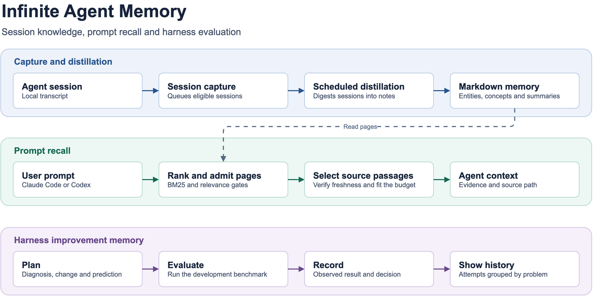

# Architecture



[Editable draw.io source](diagrams/memory-architecture.drawio)

## Memory lifecycle

| Entry point | Input | Output |
|---|---|---|
| `hooks/session-capture.js` | Eligible session transcript and metadata | Pending entry in `_capture-queue.jsonl` |
| `scripts/distill.sh` and `scripts/distill.ps1` | Queued transcript digests | Markdown sources and durable notes |
| `hooks/session-recall.js` | Vault `index.md` and pending queue count | Startup context |
| `hooks/prompt-recall.js` | Prompt and local Markdown index | Up to two source-labelled excerpts within 2,800 characters |
| `scripts/improvement-memory.js` | Proposed changes, predictions and measured outcomes | Local attempt history under `_improvements/` |

The Markdown vault is the source of truth for task knowledge. `_recall-index.json` is a derived search cache. The pending queue and `_recall-state/` hold workflow state. The SIM history is written explicitly through `plan` and `record` and is read through `show`.

## Prompt recall

The recall hook ranks pages, applies score and topicality gates, then checks session deduplication and the daily limit. In BM25 mode the highest eligible page becomes the first pick. A second pick must also pass the gates and score close enough to the first. Repeated query words and their suffix variants count once toward topicality.

For the selected pages, the hook compares the current file size and modification time with the index before presenting an excerpt. It can add a matching passage from `What`, `Key facts` or `Decisions`, retaining headings and source references. It reads at most 64 KiB from each selected file for that additional passage. Pages beyond that size use their cached overview. A detected change skips the old page and marks the index for refresh on the next eligible prompt.

This design applies extractive selection after retrieval so the ranking score and the evidence shown to the agent can be evaluated separately. [RECOMP](https://proceedings.iclr.cc/paper_files/paper/2024/hash/bda88ed2892f5e61c9a9bf215c566913-Abstract-Conference.html) · [LongMemEval](https://arxiv.org/abs/2410.10813)

Scheduled distillation and prompt-time retrieval are separate operations. The core recall path is local. The standard distiller calls the configured headless agent and can use the optional [PII routing layer](../scripts/rag/README.md#pii-routing-and-the-gazetteer). [The components of agent memory](https://www.anthropic.com/research/components-of-agent-memory)

## Repository map

| Responsibility | Paths | Entry point or dependency |
|---|---|---|
| Agent lifecycle | `hooks/`, `integrations/` | The installers register hooks and optional client adapters. Adapters translate each client's event and output format. |
| Durable knowledge | `memory/`, `scripts/` | The installers initialize a vault. Scheduled distillation and on-demand utilities read or maintain it. The optional RAG layer lives under `scripts/rag/`. |
| Agent commands | `commands/`, `skills/` | `--with-skills` installs the slash-command entrypoints and their instructions. |
| Graph and downstream testing tools | `graph/`, `e2e/` | The graph skill starts the graph server on request. `--with-e2e` installs a template into a downstream project. |
| Development | `tests/`, `docs/` | The Node suite exercises the repository, including hooks and installers, from temporary fixtures. This document and its diagram describe the runtime paths. |

The root contains the install and removal entrypoints, package manifest, license, and contributor and user documentation. `.project-structure.json` lists the allowed root entries and prevents runtime JavaScript areas from depending on repository tests.

```sh
node .harness/projectstructuur/tools/project-structure-check.js --repo .
node --test
```
